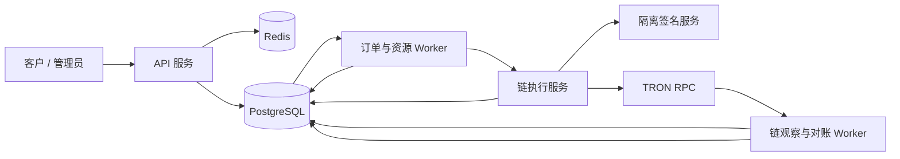

# TRON Energy / Bandwidth 租赁平台：第一版设计

版本：0.2（PostgreSQL 方案，设计评审稿）  
实现状态及与本设计的差异见 [第一版运行说明](implementation-v1.md)。本文件保留完整设计目标。
日期：2026-11-26  
实现语言：Python；业务主数据库与审计：PostgreSQL；缓存与限流：Redis。第一版不部署 ClickHouse。

## 1. 目标与边界

基于 TRON Stake 2.0，为客户提供指定地址、指定期限的 Energy 或 Bandwidth 委托，支持报价、订单、执行、链上确认、到期回收、失败处理与转账费用估算。

第一版采用平台自营资源池、API 优先、人工结算的 B2B 模式。资源池预先完成 Stake 2.0 质押；平台不保管客户私钥、不执行客户转账。人工结算意味着管理员核实外部付款后批准订单，不提供充值余额与自动扣款。此选择避免第一版引入资金账本，但不省略履约与结算审计。

### 1.1 必须实现

| 功能 | 第一版行为 |
|---|---|
| 资源查询 | 查询客户资源余额、资源池可委托额度及节点同步状态 |
| 租赁报价 | 根据资源量、期限、价格版本生成有期限的报价 |
| 订单 | 创建、查询、批准、履约前取消；每单只租一种资源 |
| 委托 | Energy / Bandwidth 委托、幂等执行、固化确认 |
| 回收 | 到期撤销委托、重试、恢复容量核验 |
| 费用估算 | 原生 TRX 转账、白名单 TRC-20 transfer（包含 USDT） |
| 运维 | 资源池配置、暂停接单、手工重试、对账与告警 |
| 可追溯性 | 结构化日志、业务审计、链上交易记录 |

暂不实现：开放资源供应商市场、自动充值/退款、用户余额、动态竞价、自动质押/解质押、任意合约调用、前端商城。质押和资金调拨由运营独立执行，平台读取结果。

## 2. 链上语义与产品承诺

链上委托参数是以 sun 表示的质押 TRX 份额，不是直接指定 Energy 数量。订单同时保存目标资源量与实际委托份额，整数计算并向上取整。资源额度随网络资源权重变化，不能承诺整个租期内固定不变。

仅委托平台自己的 Stake 2.0 可用份额；接收到的委托不能再次转租。执行前核验接收地址已激活、非合约、非资源池本身，并检查 `getcandelegatedmaxsize`。最小委托份额和锁定规则由链适配层校验。[官方委托说明](https://developers.tron.network/docs/delegation)

V1 默认使用 `lock=false`，租期由平台调度器保证，不宣传链上不可撤销保障。后续增加锁定产品时，单独处理锁定周期、追加委托导致的锁期影响及到期时间换算。

交付定义：委托交易已固化、成功且委托关系可核验。租期从该交易区块时间起算；到期进入回收流程，回收可能因链或节点故障延迟。同一资源池地址、接收地址、资源类型只允许一个未完成订单，避免聚合委托关系与订单回收相互干扰。

资源使用后逐步恢复，撤销委托不等于资源立即可再次出租。回收后重新读取可委托额度，未恢复部分标记为冷却容量。[资源模型](https://developers.tron.network/docs/bandwidth-and-energy)

## 3. 架构



| 服务 | 职责 | 扩展方式 |
|---|---|---|
| api-service | 鉴权、参数校验、订单与估算 API、管理 API | 无状态多副本 |
| rental-worker | 报价、容量预占、订单状态机、到期任务 | 按资源池地址分片 |
| chain-service | RPC 适配、估算、交易构建、广播与追踪 | 读请求多副本；写请求按池串行 |
| signer-service | 独立权限边界、交易策略检查与签名 | 每池一个有效写入实例 |
| observer-worker | 固化确认、资源快照、故障恢复与周期对账 | 按池/区块范围分片 |

日志与审计作为公共模块而非额外业务微服务：业务审计随业务事务写入 PostgreSQL；应用日志以 JSON 输出，由采集器集中收集。开发环境可以同机部署各服务，生产分别容器化部署。服务间采用 HTTP，异步任务以 PostgreSQL 事务 Outbox 表持久化，由 Worker 直接轮询领取；V1 不依赖 Redis Streams。

V1 采用共享 PostgreSQL 集群、明确表所有权的微服务部署方式。rental 拥有订单、预占、审计及 Outbox，chain 拥有交易尝试记录；observer 通过内部接口提交观察结果，不随意跨服务修改订单。服务分别使用最小权限数据库角色。共享存储是降低第一版运维复杂度的选择，不承诺各服务数据库完全独立。

## 4. 存储与事务一致性

PostgreSQL 是订单、预占、幂等、任务和审计的唯一业务事实来源；链上已确认结果以 TRON 为准。Redis 仅保存可重建缓存和限流计数，不决定订单状态或可售库存。采用当前状态表 + 追加事件记录，不要求通过全量事件重放才能查询或恢复订单。

### 4.1 事务边界

创建订单时，在一个事务中写入幂等记录、订单和审计；批准订单时，在另一个事务中完成状态检查、资源预占、状态变更、审计及 Outbox 任务写入。任何一步失败整体回滚。API 仅在提交成功后返回受理成功；提交结果未知时按原幂等键查询，不生成新命令。

默认使用 READ COMMITTED；分配资源时 `SELECT ... FOR UPDATE` 锁定池容量行，再检查快照时效、可用量与未落链预占。也可使用带容量条件的原子 UPDATE 并检查影响行数。所有容量修改遵循同一锁定协议，统一锁顺序，死锁或版本冲突时有限重试。不得在持锁事务内调用 RPC、签名或 HTTP。

链上快照在事务外获取，在事务内检查快照版本和新鲜度后更新；不能用旧快照覆盖较新结果。广播前仍需复核链上容量。

### 4.2 Outbox 与交易执行

1. Worker 使用 `FOR UPDATE SKIP LOCKED` 批量领取已到执行时间的任务，在短事务中设置 owner、lease_until、递增 claim_version 后提交。
2. 通过幂等内部接口向 chain-service 提交 operation_id。chain-service 的唯一约束保证重投不会创建第二个业务操作。
3. 构建交易，持久化 operation_id、attempt、txid、原始交易和 expiration，再签名；签名结果持久化后才广播。
4. 广播结果先写交易记录；由可重试结果通知或 rental 主动轮询推进订单，订单变更、审计和后续任务仍在同一事务内提交。
5. Worker 完成或续租必须匹配 owner 和 claim_version，过期 Worker 不能覆盖新领取者状态。失去租约后停止新操作；已提交的链执行命令仍按 operation_id 对账。

Outbox 是数据库内的持久任务队列，按至少一次语义处理。业务操作与任务具有唯一键，不能把消息去重等同于链上 exactly-once。任务超时可以重新领取，但不能据此创建新交易尝试。到期回收以 PostgreSQL 的到期时间和索引扫描为准，不依赖 Redis 定时键。

### 4.3 分布式安全与恢复

每池签名和广播保持单写通道，跨池并行。数据库任务租约不能撤回已经签出的交易。V1 写执行实例故障迁移仍需隔离旧实例的签名与 RPC 出口权限、核实未决交易，再启用新实例；无法隔离时暂停该池。

PostgreSQL 不可用时拒绝新业务写入，停止发起新的签名/广播；已在途交易可能继续上链，恢复后必须对账。Redis 不可用时绕过缓存并有界访问数据库/RPC；无法可靠执行限流的公网入口保守限流或返回 503，后台回收和订单数据不依赖 Redis。

恢复流程：加载数据库中的非终态订单与交易尝试，检查链上 txid 和委托关系，修复状态并恢复到期任务，最后重建缓存。未知委托隔离人工处理。备份恢复或数据库主切换后，先冻结相关池并对账，再开放写执行。

生产 PostgreSQL 采用主备、WAL 归档与定期恢复演练。关键写入使用同步提交，并根据可接受 RPO 配置同步副本；异步复制不得宣称故障切换零丢失。主切换必须隔离旧主；库存与幂等检查读取主库，不读取可能延迟的只读副本。数据库复制不会提供跨链原子性。

### 4.4 数据表与约束

| 表 | 关键字段 / 约束 |
|---|---|
| orders | id, tenant_id, quote_id, pool_id, receiver, resource_type, stake_sun, status, version, expires_at |
| quotes | id, tenant_id, target_units, stake_sun, duration_seconds, price_sun, price_version, expires_at |
| pool_resources | pool_id, resource_type, max_delegatable_sun, reserved_sun, snapshot_block, version；池和资源类型唯一 |
| reservations | order_id 唯一, pool_id, stake_sun, status, expires_at |
| idempotency_keys | tenant_id + route + key 唯一, request_hash, command_id, response |
| order_events | event_id 主键, order_id + version 唯一, type, payload, occurred_at |
| chain_operations | operation_id 主键, order_id + action 唯一, status |
| chain_transactions | operation_id + attempt 唯一, network + txid 唯一, raw_tx, signed_tx, status, expiration, block_number |
| outbox_tasks | task_id 主键, dedupe_key 唯一, type, payload, status, available_at, owner, lease_until, claim_version, attempts |
| resource_snapshots | pool_id, resource_type, block_number, max_delegatable_sun, observed_at |
| audit_events | event_id 主键, actor, action, target, request_id, before, after, reason, result, txid |

同池、接收地址、资源类型的未结束履约订单使用部分唯一索引限制；仅已分配池且尚未安全释放的订单参与，RECONCILING 也占用该约束。价格、份额和资源量使用 BIGINT，并设非负检查；时间使用 timestamptz；扩展事件载荷使用 JSONB，关键查询字段保持独立列。

索引至少覆盖 `(tenant_id, created_at)`、待回收订单的 expires_at、待执行任务的 available_at、未决交易状态。各服务所有权内使用外键；跨服务关联使用稳定 ID 和对账。应用读写强制租户过滤。保留幂等记录至少覆盖订单生命周期与重试窗口；归档订单时保留必要去重记录，禁止删除未完成任务或未决交易。

Redis 缓存采用短 TTL，提交成功后尽力失效；失效失败由 TTL 收敛。缓存不得参与库存决策。第一版无需 ClickHouse，后续仅在日志与分析规模需要时异步导出数据，不进入订单提交关键路径。

## 5. 订单与资源流程

```text
PENDING_APPROVAL → RESERVED → DELEGATING → ACTIVE → RECLAIMING → COMPLETED
        ↓             ↓           ↓                     ↓
     CANCELLED      EXPIRED   RECONCILING           RECONCILING
```

明确的链上失败可进入 FAILED；广播超时、节点结果冲突进入 RECONCILING，不直接判失败。ACTIVE 后不支持客户提前取消；管理员紧急回收必须填写原因并审计。

1. 报价不预占库存；返回有效期、估计份额与报价版本。默认有效期 30 秒，可配置。
2. 客户携带报价和幂等键创建待批准订单。管理员确认结算凭据；报价过期时重新报价并要求客户接受，不擅自修改金额。
3. 批准后按实时链上额度及本地未落链预占分配资源池；PostgreSQL 事务原子预占，同池串行执行，防止超卖。
4. 广播前再次检查容量、地址、参数与交易有效期。已广播的订单不得因预占 TTL 到期释放库存。
5. 固化成功后 ACTIVE，记录实际份额及到期时间。交付前可安全失败则释放预占；已付款失败订单生成待人工退款事项及处理记录。
6. 定时扫描 PostgreSQL 到期订单，提交撤销命令；固化成功后 COMPLETED。重新读取链上可委托额度，避免已恢复容量与本地释放重复计算。

资源映射：`stake_sun = ceil(target_units × total_resource_weight / total_resource_limit × 1_000_000)`，前提是节点返回的 weight 单位为 TRX；适配器必须显式校验单位，不能直接混用 sun。实际金额按链规则向上调整，并预留可配置余量。交付记录同时返回计算时的区块和资源权重。

链上实际资源可用量和本地尚未上链预占分别记账：仅扣除尚未反映在链快照中的操作，使用快照区块与交易区块消除双扣。待确认交易期间保守冻结相应份额。

## 6. 交易执行与幂等

客户端写请求必须携带 `Idempotency-Key`，作用域为租户 + 接口。相同键及相同请求返回原结果；相同键不同请求返回 409。

广播超时优先查询既有 txid，允许重播同一份已签名交易，不立即重建。只有固化区块时间已越过原交易 expiration，并检查相关区块确认原交易未包含，才允许生成新 attempt；证据不足继续等待或人工处理。[官方交易错误处理说明](https://developers.tron.network/docs/errors)

广播成功不是履约成功。观察器同时检查固化交易、执行结果与委托关系；未固化结果只用于进度展示。撤销委托使用同样流程。重试采用指数退避和抖动；超过阈值进入待处理队列，订单仍保留真实的未知状态。

## 7. 转账 TRX 消耗估算

估算 API 只模拟，不签名、不广播。返回资源消耗、预计燃烧 TRX、附加费用、建议 fee_limit、数据时间和估算可信度；租金与网络费用分别返回，转账本金不计入网络费用。

### 7.1 输入与步骤

输入包括网络、发送地址、接收地址、转账类型、金额、可选白名单合约地址、预期签名数量。金额全部为最小单位整数，禁止 float。

1. 获取账户激活状态、资源余额、合约配置与最新链参数。
2. 构造实际交易形状；按序列化数据、签名数量和协议开销计算 Bandwidth，不硬编码固定字节数。
3. TRX 转账不执行合约，Energy 为零。未激活接收地址进入单独的账户创建费用分支。
4. TRC-20 使用真实 sender、recipient、amount 调用 `estimateenergy`；节点不支持时降级 `triggerconstantcontract`，标记方法和不确定性。模拟失败返回明确错误，不返回零成本。[估算 API](https://developers.tron.network/reference/estimateenergy)
5. 读取实时 `getEnergyFee`、`getTransactionFee` 及相关账户创建/权限/备注费用参数。考虑合约开发者承担份额；无法准确确定时按调用者承担全部 Energy 给出保守上界。

### 7.2 计算原则

设调用者承担的能量为 E，可用 Energy 为 A，单价为 Pe：

```text
energy_burn_sun = max(E - A, 0) × Pe
estimated_network_fee_sun = energy_burn_sun + bandwidth_burn_sun + extra_fee_sun
```

普通交易 Bandwidth 按整笔覆盖规则处理：质押/委托 Bandwidth 能覆盖整笔则使用该额度，否则尝试免费额度；两者均不足时按整笔 Bandwidth 燃烧 TRX，不能把它写成简单缺口公式。账户激活等特殊交易分支单独计算。[官方资源说明](https://developers.tron.network/docs/resource-model)

`fee_limit` 不是所有网络费用的总上限，也不等于预计烧掉的 TRX；建议值按调用者 Energy 预算加缓冲生成，并核验链上上限。资源余额、合约状态、动态能量均可能改变实际结果，因此返回估算值与保守上界，不承诺精确扣费。

缓存链参数默认 30 秒、账户资源默认 3 秒；响应包含 snapshot 时间。关键执行前重新查询。超过配置的最大陈旧时间返回服务不可用，不拿旧价格当实时值。

## 8. HTTP API

统一前缀 `/v1`；客户 API Key 映射 tenant_id，管理员采用独立身份与角色。

| 方法 / 路径 | 用途 |
|---|---|
| GET /accounts/{address}/resources | 资源及激活状态 |
| POST /estimates/transfers | TRX / TRC-20 费用估算 |
| POST /quotes | 生成租赁报价 |
| POST /orders | 创建订单 |
| GET /orders/{id} | 状态、交付、txid、租期 |
| POST /orders/{id}/cancel | 履约前取消 |
| POST /admin/orders/{id}/approve | 核实结算并批准 |
| POST /admin/orders/{id}/retry | 有条件重试，必须附原因 |
| POST /admin/pools/{id}/pause | 暂停该池新委托 |
| GET /admin/pools | 库存、冷却量与异常 |
| GET /health/live、/health/ready | 存活与就绪探针 |

创建订单示例：

```json
{
  "quote_id": "q_01",
  "receiver_address": "<Base58Check address>"
}
```

异步命令返回 202 + order_id / command_id；参数错误 422、幂等冲突或状态冲突 409、容量不足 409、限流 429、依赖不可用 503。错误体统一包含 code、message、request_id、retryable，不暴露内部堆栈。

## 9. 日志、审计与可观测性

INFO：请求结果、订单状态变化、容量分配、广播与固化结果、回收结果、节点切换。DEBUG：脱敏的节点参数、耗时、缓存命中、估算中间值、重试原因。WARN：资源偏差、节点滞后、重复事件、回收延迟。ERROR：执行失败、对账异常、签名或审计持久化失败。

JSON 公共字段：UTC timestamp、service、environment、level、trace_id、request_id、tenant_id、order_id、operation_id、txid、event、duration_ms。运营界面按 Asia/Shanghai 显示；存储时间统一 UTC。

审计记录订单批准/取消/退款登记、资源池配置、价格修改、强制回收、重试、权限变更、签名与广播。必须记录操作者、对象、原因、前后值、结果与关联交易；系统任务使用独立 actor。数据库内业务变更与审计同事务提交；链上副作用先提交审计意图，结果以新事件补充。失败事务回滚后通过独立事务记录失败尝试，不覆盖历史。

禁止记录私钥、API Key、访问令牌及完整签名原文；交易恢复数据存入受限专用表，不进入应用日志。审计使用只追加写入账号、限制删除权限、备份与完整性校验；PostgreSQL 本身不等于不可篡改存储。

应用日志通过 stdout 输出，开发环境配置文件轮转，生产由采集器集中检索与归档；高频 DEBUG 日志不写入业务数据库。采集故障不阻断业务事务，但必须监控丢弃量；业务审计失败则回滚业务事务。

默认保留：DEBUG 7 天、INFO 30 天、审计和业务事件 365 天；上线前由运营确定最终期限。指标包含：订单交付延迟、待确认交易数、到期未回收时长、可租库存、预占年龄、估算误差、RPC 错误率、Outbox 积压及最老任务等待时间、审计写入失败。签名异常、对账不平、审计不可用立即告警。

## 10. 安全与部署

签名服务不暴露公网，密钥通过独立密钥存储注入，不写入源码或普通环境日志。使用支持 TRON 所需签名格式的密钥实现，并用测试向量验证。为平台设置独立操作权限，尽可能只允许委托和撤销合约类型，禁止通用转账签名。

签名前解析交易，检查网络、owner、合约类型、接收者、金额、订单状态与到期时间；限制单笔、单池和每日操作额度。隔离主网和测试网配置、账户、Redis 命名空间与 PostgreSQL 数据库。

部署提供 Docker Compose 本地环境与容器编排清单。API 和读路径水平扩容；池级串行写入。优雅关闭时停止消费，完成持久化后交接；未确认交易由观察器继续追踪。生产至少配置两个 RPC 来源，检查链标识、固化高度和结果差异；不因单节点空响应认定交易不存在。

## 11. Python 工程与代码约束

建议 FastAPI + Pydantic 构建接口，httpx 异步访问节点，redis-py 操作 Redis，SQLAlchemy + psycopg 访问 PostgreSQL，Alembic 管理数据库迁移。实现时锁定经过兼容验证的具体版本，不在设计稿假定最新版本行为。

```text
services/
  api/             # HTTP、鉴权与请求模型
  rental/          # 状态机、报价、容量和调度
  chain/           # RPC、估算、交易构建与广播
  signer/          # 签名策略和密钥接口
  observer/        # 固化确认、资源快照与对账
packages/
  domain/          # 订单、事件与金额类型
  storage/         # PostgreSQL、Redis 适配器
  observability/   # 日志、审计与追踪
tests/
  unit/
  integration/
  testnet/
migrations/        # 数据库迁移（rental、chain 分别拥有）
config/            # local、testnet、mainnet 配置模板
deploy/
docs/
```

优先级为高效 > 简洁 > 直观；性能优化必须有测量依据，涉及批量、SQL 锁、并发和快照对齐的非直观逻辑写明原因及不变量。业务规则使用小函数和显式状态枚举，避免通用工作流引擎、复杂继承和隐式装饰器链。

I/O 并发使用有界 asyncio，RPC 连接池复用、超时分层设置；数据库连接池有界、查询使用索引并避免 N+1，关键审计同步确认与普通日志批写分开。领域层不依赖 HTTP 或数据库对象；只为真实外部边界定义接口。金额命名带 `_sun`，期限带 `_seconds`，资源类型统一使用 ENERGY / BANDWIDTH。

## 12. 测试与验收

| 场景 | 通过标准 |
|---|---|
| 两类资源完整租赁 | 测试网完成报价、批准、委托固化、到期回收和容量复核 |
| 并发争抢最后库存 | 仅一笔成功预占，无负库存、无超额委托 |
| 请求和 Outbox 任务重复 | 同一业务操作不生成重复履约交易 |
| 广播超时后服务崩溃 | 重启查原 txid，不立即重建交易 |
| Redis 丢失或切换 | 订单、预占和到期任务不丢失；缓存可重建，后台履约继续 |
| Worker 租约过期后恢复 | 旧 claim_version 无法更新任务，重复提交关联同一 operation_id |
| 写执行实例切换 | 隔离旧实例并核对未决交易后恢复 |
| 事务中途失败 | 订单状态、预占、审计和任务全部回滚 |
| PostgreSQL 故障 | 停止新业务写入和新签名/广播，恢复后对账在途交易 |
| 回收后资源未恢复 | 不立即把原份额全部重新出售 |
| 估算 | 覆盖已激活/未激活、资源充足/不足、不同 TRC-20 收款状态、模拟失败 |
| 隔离 | 跨租户查询失败，签名服务拒绝转账和越权交易 |
| 灾难恢复 | 从 PostgreSQL 备份/WAL 恢复业务记录并核对链上状态；无法归属项被隔离 |

费用测试将估算与实际 receipt 对比，分别统计 Bandwidth、Energy 与费用误差；动态状态变化不得被隐藏成固定常量。用故障注入覆盖每个持久化与广播边界。

## 13. 交付顺序与待确认项

1. 建立工程骨架、链适配、结构化日志、审计与只读估算。
2. 实现 PostgreSQL 事务状态机、Outbox、报价、人工批准及单池委托。
3. 实现固化确认、到期回收、异常重试与对账恢复。
4. 实现多池分片、监控、故障注入和测试网验收，再进行限额主网灰度。

上线前需要确定：资源池账户及规模、租期档位和定价、是否接受人工结算、退款处理时限、可接受回收延迟、审计保留期限。上述问题不影响技术骨架，但影响产品条款和生产参数。

若要求自动支付、余额或无人工干预的跨故障域写主切换，应另开设计评审；未来资金账本需要独立设计复式记账、支付确认与对账，PostgreSQL 事务不等于跨链资金原子性。
